# styrman-harness

A personal agent harness for **Claude Code** and the **Antigravity CLI** (`agy`): one global context file in the [agents.md](https://agents.md) standard, skills in the [Agent Skills](https://agentskills.io) `SKILL.md` standard, subagents, and `sh-agent` — a small Go binary that installs, resyncs, inspects, and removes all of it, and gives every session a local search index of the project it works in (`sh-agent search`). No hooks, no gates, no CI, no service.

## How it works

This map is the contract for how the harness reaches a machine and how experience comes back. The strict rules that keep it true are in `AGENTS.md` § How the harness works; `TestHarnessMap` fails when the map names a command the binary does not have.

```mermaid
flowchart LR
    subgraph checkoutLane["Your harness checkout"]
        edit["Edit context/, skills/, agents/, commands/, rules/"]
        ship["gofmt, vet, test -race<br/>commit and push main"]
        preflight["/preflight vX.Y.Z<br/>tag, binaries and zip, no key"]
        retroHarness["/retro --harness<br/>applies the proposals queued on this machine"]
        readReports["Read reports/HOST/RUN/<br/>by hand: not built yet"]
    end
    subgraph githubLane["GitHub, private"]
        harnessRepo[("styrman-harness<br/>main: what checkout places follow<br/>tags: release markers")]
        releases[("Releases<br/>platform binaries + release zip + SHA256SUMS")]
        feedbackRepo[("styrman-harness-feedback<br/>reports/HOST/RUN/")]
    end
    subgraph placeLane["Each place"]
        checkoutPlace["Checkout<br/>the normal path"]
        binaryPlace["Release binary<br/>harness built in, no repository"]
        zipPlace["Zip place<br/>repo zip downloaded by hand, no tree kept"]
        installer["sh-agent install / sh-agent update"]
        homeFiles["~/.claude and ~/.gemini/config<br/>installed files, no repository"]
        sessions["Claude Code and Antigravity sessions<br/>feedback-log skill logs, /retro queues"]
        configDir["~/.config/sh-agent/<br/>feedback.jsonl, retros.jsonl, proposals/, state.json, search.db (a cache, never sent)"]
        dreamer["sh-agent dream --all<br/>nightly user timer, a CLI with no tools"]
        reporter["sh-agent report<br/>throwaway clone, pushed, then removed"]
    end
    edit --> ship
    ship -- "git push" --> harnessRepo
    ship --> preflight
    preflight -- "tag marks a version" --> harnessRepo
    preflight -- "binaries, zip and SHA256SUMS" --> releases
    harnessRepo -- "clone once, update pulls" --> checkoutPlace
    releases -- "update downloads and checks" --> binaryPlace
    harnessRepo -. "zip, downloaded by hand; update --from-zip repeats it" .-> zipPlace
    releases -. "release zip + SHA256SUMS, by hand; checked" .-> zipPlace
    checkoutPlace --> installer
    binaryPlace --> installer
    zipPlace -.-> installer
    installer -- "writes files" --> homeFiles
    homeFiles -- "read at session start" --> sessions
    sessions -- "logs" --> configDir
    configDir -- "copy and redact" --> reporter
    reporter -- "git push" --> feedbackRepo
    feedbackRepo -.-> readReports
    configDir -. "same machine only" .-> retroHarness
    readReports -.-> edit
    retroHarness --> edit
    sessions -- "memory, trail, transcripts" --> dreamer
    dreamer -- "proposals/dream/" --> configDir
    dreamer -. "redacted prompt, no tools" .-> provider[("the CLI's model provider")]
    linkStyle 0,1,5,6,7,8 stroke:#0B7A74,stroke-width:2px
    linkStyle 2,3,4 stroke:#8A3A78,stroke-width:2px
    linkStyle 9,10,11,12,13 stroke:#3B4FB8,stroke-width:2px
    linkStyle 14,15,16,17,18,19,20 stroke:#A8660F,stroke-width:2px
    linkStyle 21,22,23 stroke:#5B7F1E,stroke-width:2px
```



Teal is **update**, indigo **install**, amber **report back**, plum **release**, olive **learn** (the nightly dreamer: on the machine, neither a way in nor a way back; its one dashed line is what it sends off the machine, a redacted prompt to the CLI's model provider, ADR-049). A dashed line is a gap: done by hand, or limited to one machine.

- **Install:** clone `styrman-harness` with your own SSH key or `gh` login and run `go run ./cmd/sh-agent install`, or download a release's `sh-agent` binary with that credential and run `sh-agent install`, which installs the harness built into it (§ Install without cloning). Either way installed files go into `~/.claude` and `~/.gemini/config`, no repository is created, and the next session reads them. A machine that can reach neither downloads the repository zip by hand instead (§ Install from a zip (no SSH, no gh)).
- **Update:** edit and push `main` in your checkout. At each place, when you decide, `sh-agent update` moves it forward — what that means for a checkout place, a binary-only place and a zip place is `.agents/docs/specs/sh-agent/delivery.md` § The model. Nothing pushes to a machine.
- **Report back:** sessions log corrections and retros under `~/.config/sh-agent/`. Before each report, read what was added since the last one. `sh-agent report` sends a redacted copy and a metrics record to `styrman-harness-feedback` through a throwaway clone holding only this machine's own reports, removed after the push — no machine keeps a copy of any other's. Back at the harness, `/retro --harness` applies the proposals queued on that machine; other places' reports are read by hand.
- **Release:** `/preflight vX.Y.Z` in your own turn gates, pushes an annotated tag on `main`, and publishes that tag's binaries and a zip of its tree with their `SHA256SUMS` — no key, so any machine where you are logged in to GitHub can cut one; what each kind of place does with it is `.agents/docs/specs/sh-agent/delivery.md` § The model.
- **Dream** (olive, on each place): once per machine, `sh-agent dream --install-timer` installs a user timer (systemd on Linux, launchd on macOS). Nightly it runs `sh-agent dream --all`: every indexed project that changed sends its memory, new trail, feedback and both CLIs' transcripts, redacted, to a CLI with no tools. The proposals and draft skills land in `~/.config/sh-agent/proposals/dream/`; `/retro` applies them, and `sh-agent report` carries the harness-target ones back. `--remove-timer` or `uninstall` removes it (R3's exception, `.agents/docs/specs/sh-agent/dream.md`).

## Install

```bash
git clone git@github.com:kesokaj/styrman-harness.git ~/workspace/styrman-harness
cd ~/workspace/styrman-harness
go run ./cmd/sh-agent install     # builds the binary from the checkout, deploys everything, installs the build to ~/.local/bin/sh-agent
sh-agent status                   # should end with "drift none"
```

Make sure `~/.local/bin` is on your `PATH`. Requires Go 1.24+ and git; the first build of a version fetches one Go module, the pure-Go SQLite driver behind `sh-agent search` (R4, ADR-045). `install` writes Claude Code's attribution setting, `"attribution": {"commit": "", "pr": ""}` in `~/.claude/settings.json`, when the key is absent, so no commit carries a Co-Authored-By trailer; `status` prints a note when the file is missing or sets `commit` to anything else, and both print the same note when the file is larger than 1 MiB, more than either will read or rewrite, so the setting could not be checked (see context § Git).

Harness state (feedback log, retro proposals and index) lives in `~/.config/sh-agent/`, outside any project, beside the global search index `search.db`, a cache `report` never sends, so Claude Code asks once per session before the first read or write there. To stop the prompt, add the directory yourself to `permissions.additionalDirectories` in `~/.claude/settings.json`; the installer touches no vendor setting except the attribution key (ADR-025). `~/.config/sh-agent/` is created 0700 and tightened to it by every install when it is yours and not a symlink (either case gets a `note:` instead), since the feedback log and proposals live there.

## Install without cloning

A machine that only USES the harness needs no checkout: a release binary carries `context/`, `skills/`, `agents/`, `commands/` and `rules/` inside it, and installs them. Any of these gets you the binary, all with your own GitHub credential — the repository is private, so a download works only when you are logged in or hold the key:

```bash
# gh, the shortest path — ONE chained command, so a failed check stops the move. V is the
# version you expect, from a source OUTSIDE the download: the operator who cut it, or a checkout's
# changelog — not the Releases page, which is the same server the assets come from. Two lines tie
# the download to it — the checksum file must name V, and the binary must be V — which is what
# `sh-agent update` does with the tag it asked for (update also refuses a tag that is not newer
# than what it has, which no first install can mirror). The guarantee is "the version you named,
# or nothing" — never "the newest". The checksums are not signed (ADR-053): they prove the
# download is whole; who made the release rests on your GitHub credential and HTTPS. Everything
# is checked in a scratch directory and only the binary moves to ~/.local/bin. --clobber because
# a leftover file from an earlier attempt makes the download refuse. On macOS replace
# `sha256sum -c -` with `shasum -a 256 -c -`.
V=vX.Y.Z \
&& D=$(mktemp -d) && cd "$D" \
&& gh release download "$V" --repo github.com/kesokaj/styrman-harness --clobber \
     --pattern 'sh-agent-linux-amd64' --pattern 'SHA256SUMS' --dir "$D" \
&& grep -qxF "# styrman-harness $V" SHA256SUMS \
&& grep -v '^#' SHA256SUMS | sha256sum -c - --ignore-missing \
&& chmod +x sh-agent-linux-amd64 \
&& test "$(./sh-agent-linux-amd64 version)" = "sh-agent $V" \
&& mv sh-agent-linux-amd64 ~/.local/bin/sh-agent && cd ~ && rm -r "$D"
```

```bash
# or go install, for v1.1.0 or newer (v1.0.0 has no harness built in). The module path
# is an https URL and the repository is private, so git must be told to fetch it over
# SSH — without this it fails with "could not read Username for 'https://github.com'".
# What this route trusts: the SSH connection to GitHub and git's own object hashes.
# GOPRIVATE turns the checksum database off, and no release signature is checked, so
# use it where you already trust the repository, not to bootstrap trust on a new machine.
# This form changes no git config:
GOPRIVATE='github.com/kesokaj/*' \
  GIT_CONFIG_COUNT=1 \
  GIT_CONFIG_KEY_0='url.git@github.com:.insteadOf' GIT_CONFIG_VALUE_0='https://github.com/' \
  go install github.com/kesokaj/styrman-harness/cmd/sh-agent@v1.1.0
# (or, if you would rather set it once for this machine:
#   git config --global url."git@github.com:".insteadOf https://github.com/ )
```

```bash
# or the Releases page in a browser: download the binary and SHA256SUMS to
# ~/Downloads, then the same checks in a scratch directory so nothing else in ~/Downloads is
# touched — ONE chain, shown for a Mac (on Linux: `sha256sum -c -`, and no xattr step). The
# `ls` stops the chain before anything moves when a file is missing; the `xattr` line lifts the
# browser quarantine, which would otherwise stop the binary from running at all:
V=vX.Y.Z \
&& ls ~/Downloads/sh-agent-darwin-arm64 ~/Downloads/SHA256SUMS >/dev/null \
&& D=$(mktemp -d) && mv ~/Downloads/sh-agent-darwin-arm64 ~/Downloads/SHA256SUMS "$D" && cd "$D" \
&& grep -qxF "# styrman-harness $V" SHA256SUMS \
&& grep -v '^#' SHA256SUMS | shasum -a 256 -c - --ignore-missing \
&& chmod +x sh-agent-darwin-arm64 && { xattr -d com.apple.quarantine sh-agent-darwin-arm64 2>/dev/null || true; } \
&& test "$(./sh-agent-darwin-arm64 version)" = "sh-agent $V" \
&& mv sh-agent-darwin-arm64 ~/.local/bin/sh-agent && cd ~ && rm -r "$D"
```

Then:

```bash
sh-agent version     # FIRST, unqualified: the version you just downloaded, or another sh-agent is winning
sh-agent install     # installs the harness built into the binary
sh-agent status      # "source embedded vX.Y.Z" and "drift none"
```

`sh-agent version` comes first on purpose. Moving a verified binary into place is not the same as installing it: if any earlier `PATH` entry holds another `sh-agent`, that one runs instead, installs whatever source *it* resolves, and reports `drift none` about it — a machine installed a stale tree this way and every command said it had succeeded (BUG-078). `install` and `status` now name such a binary (`warning: … comes before … on PATH` and a `shadowed` line), but the one-word check above is the fastest confirmation. It tells stale from fresh, never genuine from forged — it is printed by the very binary in question; where it came from is your GitHub login and HTTPS, and that it arrived whole is the checksum, before the move (ADR-053). When it names the wrong version: first `hash -r` (bash) or `rehash` (zsh) and run it again — a shell caches where it last found `sh-agent`, and `update` replaces `~/.local/bin/sh-agent` and nothing else, so a shell that once resolved the name to another copy keeps running that copy whatever PATH says (`type sh-agent` shows the cached path; `update` now says so when it ran from such a copy, but only when the update ran against your real home, never a `--home` elsewhere). Still wrong after that: `which -a sh-agent` lists every candidate in order; point the earlier one at this binary (`ln -sfn`) or remove it — a link to the same file is not a shadow and silences the warning; when that earlier file is not yours, the note says it is not yours to relink and to remove it with the rights that own it, or leave it and run the installed one by its path.

Make sure `~/.local/bin` is on your `PATH`. The assets are `sh-agent-linux-amd64`, `sh-agent-darwin-arm64` and `sh-agent-linux-arm64`, beside `SHA256SUMS` (v2.4.0 also carries a `SHA256SUMS.sig`, for v2.3.2 binaries only; ADR-053).

On macOS, a binary downloaded **in a browser** is quarantined and will not run until the attribute is removed; the browser chain above does that (`xattr -d com.apple.quarantine`) before it runs `version`. One fetched by `gh` or `go install` is not quarantined.

To move such a place forward, run `sh-agent update` there: it asks GitHub for the newest release, refuses anything that is not a canonical `vX.Y.Z` tag (no leading zeros) newer than what is installed — an older or equal release prints "the newest release X is not newer than this binary Y; nothing installed" — checks the binary against the release's `SHA256SUMS`, and only then replaces itself and reinstalls. It needs `gh` on `PATH` (`gh auth login` once). `sh-agent update --check` only reports, exiting 2 when a newer release exists. `sh-agent adopt` needs a checkout and says so.

## Install from a zip (no SSH, no gh)

A machine that can neither hold your SSH key nor run `gh` — a corporate workstation, say — still reaches the harness: download a release's `styrman-harness-vX.Y.Z.zip` and `SHA256SUMS` from the Releases page into one folder, together with its `sh-agent` binary (§ Install without cloning covers verifying the binary), and run the command below. A zip of `main` ("Code → Download ZIP") works too, but no release lists it, so nothing checks it:

```bash
sh-agent update --from-zip ~/Downloads/styrman-harness-vX.Y.Z.zip   # SHA256SUMS beside it: checked
sh-agent update --from-zip ~/Downloads/styrman-harness-main.zip   # a main zip: nothing to verify, installed marked UNVERIFIED
sh-agent status      # "installed … from zip sha256:<hex> (verified vX.Y.Z)" or "(unverified)"; reports presence, not content — the zip is not kept
```

`--from-zip` unpacks the zip into a temporary directory (under `~/.config/sh-agent/`, or beside the zip before that directory exists), installs that tree and the running binary, and deletes the directory (`--dry-run` unpacks and removes the same directory and writes nothing into the home); The binary is copied into `~/.local/bin` the way every install copies it, but nothing in the zip replaces it and nothing is fetched. `--dry-run` does the same unpack-and-plan without writing a file, a manifest, or a binary, and still removes the temporary directory. With the release's `SHA256SUMS` beside it, the zip is checked before anything is written against its own checksum line, which needs the release's own file name. The first line then says `CHECKED against the SHA256SUMS of release vX.Y.Z (integrity only)`, and any failure refuses the zip. Without it — a `main` zip, or a release zip downloaded alone — the zip is installed and the first line says `UNVERIFIED`: the zip place is the fallback for a machine that cannot take the normal way in, so it accepts the zip you give it, and trust rests on your own download (ADR-041). `update --dry-run` on the other two kinds of place reports what an update would do and changes nothing. Moving a zip place forward means repeating the download and `--from-zip`; a zip whose harness needs a newer binary means downloading that binary by hand too.

## Daily commands

| Command | What it does |
|---|---|
| `sh-agent status` | Shows what is installed, from which commit, the running binary's build (with a warning when it is older than the checkout), a note when `~/.claude/settings.json` is missing or sets `attribution.commit` to anything but `""` (install writes the key when it is absent), a `dream` line (last run, projects, proposals, timer installed or not; it appends `; legacy timer files under <home>: sh-agent dream --remove-timer --dry-run --home '<home>' prints the cleanup steps` when v2.0.0 or earlier left bare-named unit files in a home whose own unit name is suffixed), and every file that drifted. A destination that is a symlink, or lies under a symlinked directory, is reported as `foreign`, never as drift. Exit 1 on drift. |
| `sh-agent diff` | Unified diff of every drifted file (installed vs repo); renders its temporary copies under `~/.config/sh-agent/`, removed after, never the system temp dir. |
| `sh-agent install` (or `sync`) | From its own git checkout, rebuilds the binary with `go build`, then deploys the repo; from a release binary deploys the harness built into it and copies the running binary (nothing to build from); from a plain copy (no `.git`) deploys the running binary as is (`--vendor antigravity\|claude\|all`). Idempotent; removes files a previous install wrote that the repo no longer has. `--dry-run` prints what would change without changing anything. Every run prints one line per file it changes — `add` (not there before), `update` (other bytes, or a previous file it could not read), `mode` (permission corrected, bytes unchanged, and also the runtime directory `~/.config/sh-agent`, tightened to 0700 by every install when it is yours and not a symlink (either case gets a `note:` instead)), `remove` (no longer in the source) and `keep` (a managed path holds a file sh-agent did not write and it is left alone; a destination that is a symlink, or any path under a symlinked directory, prints `keep    ~/<path> (a symlink; sh-agent never writes through a link)`, is counted under `kept`, is never read through, chmodded, replaced or removed, and never enters the manifest; `diff` and the resync loop skip it) — and counts the unchanged; when a write fails midway the manifest is saved once as every old entry still on disk plus the files written so far, so `uninstall` still removes everything sh-agent wrote; `--dry-run` prints the same lines and writes nothing. |
| `sh-agent update` | At a checkout: `git fetch`; refuses a checkout with uncommitted changes, because it deploys the working tree rather than the fetched commit (BUG-046), and does so before `--check` and `--dry-run` return, so those print the same refusal and exit 1 on a dirty checkout (a clean one exits 2 when behind, 0 when current); if behind, `pull --ff-only`, rebuild, and reinstall. At a release-binary install: downloads the newest release, refuses a tag that is not `vX.Y.Z` or is not newer, checks the binary against the release's `SHA256SUMS`, replaces `~/.local/bin/sh-agent` and reinstalls. Either way `--check` only reports (exit 2 when behind or when a newer release exists). It also removes the full feedback clone older versions kept at `~/.config/sh-agent/feedback`, when that clone is clean and fully pushed. A zip place runs `update --from-zip <file>` instead (§ Install from a zip); `update --dry-run` reports what an update would do and changes nothing. |
| `sh-agent uninstall` | Removes exactly the files it installed (from its manifest) and nothing else (a symlinked path is kept and prints the same `keep` line as install), plus the dream timer when one is installed (R4), even with no manifest left; it says `removed the dream timer` only when it removed one, and names legacy bare-named unit files it leaves alone, as `--remove-timer` does. `--dry-run` prints what would be removed, the timer included, without removing anything or calling `systemctl`/`launchctl`. A unit file that belongs to the other operating system (a home copied between a Mac and a Linux box) is named and stays, in a dry run too; `dream --remove-timer` says the same, with and without `--dry-run`. |
| `sh-agent dream --install-timer` / `--remove-timer` | Installs or removes the nightly `sh-agent dream --all` job: a systemd user timer (Linux) or a launchd agent (macOS), running with the absolute entries of the PATH of the shell that installed it (a `claude` or `agy` reachable only through a relative entry is not found at 03:00). `--dry-run` writes nothing and calls no manager. An installed unit that differs from what would be written is kept and named; run `--remove-timer` first. The unit's name is per home (the real home keeps `sh-agent-dream` / `com.styrman.sh-agent-dream`; any other `--home` gets a suffix of eight hex digits of the path's SHA-256) and its command carries `--home "<home>"`; a place updating from v2.0.0 runs `sh-agent dream --remove-timer` then `--install-timer` once, because the differing unit is never overwritten. `--remove-timer` prints `dream timer removed`, or `no dream timer found for <home> on this system` when it removed nothing (exit 0 both ways). A unit file that v2.0.0 or earlier wrote under the bare name in a home whose own unit name is now suffixed is never removed or stopped by the binary (a stop by name ends whichever unit the service manager loaded): `--remove-timer` (also with `--dry-run`) prints the paths, the check (`systemctl --user show -p FragmentPath sh-agent-dream.timer`, or `launchctl print gui/<uid>/com.styrman.sh-agent-dream`) and the steps (rest: `.agents/docs/specs/sh-agent/dream.md`). |
| `sh-agent list` | Prints the skill and agent inventory. |
| `sh-agent render` | Prints the assembled context file. |
| `sh-agent adopt <name\|path>` | Copies a skill installed elsewhere (for example by `npx skills add -g`) into `skills/`. `--force` replaces an existing skill of the same name. On a release binary it refuses, naming a checkout to build from instead; on a plain copy it adopts but says next to copy the skill into a checkout and commit there, since the plain copy has no repository. |
| `sh-agent report` | Sends a redacted copy of `~/.config/sh-agent/` (feedback log, retro index, proposals, manifest) and a `report.json` metrics record to the private feedback repository, one directory per machine per run. It clones a throwaway holding only this machine's reports, pushes, and removes it — nothing of that repository stays on the machine. `--dry-run` prints every file and redaction and writes nothing; `--feedback-repo DIR` names a checkout to use instead, which is written into and never removed. On a release-binary install, `--repo` is ignored with a note (`report: --repo is not used here; this release binary reports the harness built into it`) — `report` always reports the harness built into the binary there. See `.agents/docs/deploy/local.md` § Report back. |
| `sh-agent search <words>` | Ranked full-text search (SQLite FTS5, BM25) of every tracked, modified and untracked file of the git checkout it runs in (a directory holding a `.sh-agent-noindex` file is left out: vendored data, not the project's own text; the header of a words search and of `--open` then ends `; left out by .sh-agent-noindex: <dir>/, <dir>/` (sorted, the checkout's root as `./`; here it names `skills/google-catalog/catalog/`), while `--refs`, `index` and `--global` print no such list), with the trail's records attached: each hit is `path:line`, its kind (`bug`, `adr`, `plan`, `code`, …), the record's ID and status (an ADR's "Superseded by …", a bug's `open`) and a one-line snippet. `--refs <BUG-NNN\|ADR-NNN\|path>` lists every record naming an ID, a file or a directory (trailing `/`), after the ID's own status line; `--open` lists open bugs and plans with unticked boxes; `--kind K` filters, `--limit N` (1–50, default 10) caps. `--global` searches the global search index instead: `~/.config/sh-agent/`'s logs and proposals and the `.agents/docs` trail of every harness-scaffolded checkout that has run `search`. Files with secret-shaped names (the installer's list, any case: `.env`, `.env.*`, `*.env`, `*.pem`, `*.key`, token and credential files) are never indexed; a secret inside an ordinarily named file is. The index is `.agents/scratch/search.db` (gitignored; refused when it is not, or when `.agents/scratch` is a symlink); before every answer it is reconciled against `git ls-files` and `git status`, so it never answers from another branch. Exact strings, regex and past revisions stay with `git grep`. Spec: `.agents/docs/specs/sh-agent/search.md`. |
| `sh-agent index` | Reconciles the search index and prints its counts (files, chunks, records, refs, changed, bytes, ms); `--rebuild` deletes and rebuilds it, `--global` does either for the global search index; the search-only flags (`--kind`, `--refs`, `--open`, `--limit`) are refused here with a usage error, as every verb refuses another verb's flags. |
| `sh-agent dream --all \| --project DIR` | The background dreamer (R3's exception). For every project in the global search index (`--all`) or one checkout (`--project`) that changed since its last dream, it collects: the memory store whole; the feedback-log lines, trail records (bugs, reviews, retros, changes, handoffs) and both CLIs' conversation text newer than the project's watermark; and the installed skills. It redacts them with `report`'s rules (each feedback-log entry passes `RedactJSONL`, the decoded-line matching, first, so an escaped secret is caught), writes the home path as `~`, and caps the prompt at 256 KB (transcripts dropped first). It sends the prompt to the CLI `--vendor` names (default: the manifest's; `all` uses Claude Code) with NO tools (`claude -p --tools ""`; `agy --input-format stream-json --output-format stream-json --mode plan -p ""`, which has no no-tools flag: the prompt goes on stdin as one stream-json message, opens with a warning that any tool call is refused and ends the run, and agy runs from a private HOME holding a copy of the login and settings that grant nothing), from an empty `~/.config/sh-agent/dream-work/`. It writes the JSON answer as queued proposals: `proposals/dream/<date>-<project>.md`, harness targets under `proposals/dream/harness/` (which `report` sends), and draft skills under `proposals/dream/drafts/`. Nothing is applied: `/retro` consumes them. A project that fails keeps its watermark, and its output goes to `dream-failed/`; the exit status is 1 when a project failed, 2 when the run failed before the first (every usage error is exit 2 with its reason on stdout). A tracked, unmodified trail record counts as changed at its newest commit's time, an untracked or modified one at its mtime; Claude Code's `isMeta` and `<local-command`, `<command-`, `<task-notification` and `<system-reminder` lines are not sent; fence runs and label newlines are escaped in the prompt; unknown keys in the model's JSON are ignored, and each proposal's text is indented four spaces in the proposal file so it cannot open a section `/retro` parses. `--dry-run` prints what each project would send and run, and writes nothing. A second run while one holds `dream.lock` exits 0. Spec: `.agents/docs/specs/sh-agent/dream.md`. |
| `sh-agent memory add --type T --name SLUG --description TEXT` | Saves one memory into the project's `.agents/memory/`: the body comes on stdin, `T` is `user`, `feedback`, `project` or `reference`, the slug names the file, and the index `MEMORY.md` gets or replaces its line. Every CLI writes memory this way, and Claude Code's own auto memory is switched off per project by `/init-project` (R10). It works from any worktree into the main checkout's store. It refuses, with exit 2 and nothing written, outside a git checkout, when `.agents`, the store or its `MEMORY.md` is a symlink, when git tracks anything in the store, when the file would not be ignored by git (run `/init-project` first), or when the index already holds 200 lines. |
| `sh-agent memory show` | Prints the project's `MEMORY.md`, capped at 200 lines and 25 KB, the part a session loads; both CLIs run it at session start. It adds one line when Claude Code's native memory is still on in this project (a scaffold from before R10: run `/init-project` there). The same trust refusals as `add`; no store prints nothing. |
| `sh-agent metrics ingest [--vendor V] [--source DIR --label KEY=VALUE [--outcome pass\|fail]]` | Reads the shape of every Claude Code session, main and subagent, into the metrics store `~/.config/sh-agent/metrics.db`. Shape means tools, normalised command verbs (program, subcommand, flag names), tokens, timings, errors, denials, interrupts, the skill name and the subagent type. It never stores arguments, prose or tool output. Antigravity is read from Phase 3 of the plan on; until then the command says so. Ingest is incremental and idempotent. It prints `metrics: N sessions, M steps, K events added; U lines skipped (unknown shape); F sources failed` and exits 1 when a source failed (each named). Transcripts come from `--source`, else `--home`, else `$CLAUDE_CONFIG_DIR` only when neither flag is given, else the home. `--source` reads a sandbox home and stamps each session with `--label` and `--outcome`. The store is a store of record, not a cache: it is migrated forward, never rebuilt, never sent by `report`, and kept by `uninstall` (R4, ADR-055). Spec: `.agents/docs/specs/sh-agent/metrics.md`. |
| `sh-agent metrics export FILE` | Writes every row of the metrics store to FILE as JSONL, one `{"table":…,"row":{…}}` per line, mode 0600. An existing FILE is refused. This is the store's only backup. |
| `sh-agent version` | Prints the build version. |

A flag a verb does not define, or an argument a verb does not take, is a usage error: the message names it and the exit status is 2 (`update --check` also exits 2 for "behind", so a script reads the message, not the code alone). Every command accepts `--vendor VENDOR` (target `antigravity` / `agy` or `claude`; default is the vendor recorded by the existing install, else `all` — `--vendor all` widens a single-vendor install to both through `install`; `update` keeps the recorded vendor instead), `--home DIR` (install somewhere other than `$HOME`, used by the tests) and, for a build made FROM a checkout, `--repo DIR`. Such a build finds the checkout from `--repo`, then `$SH_AGENT_REPO`, then the working directory or any of its parents, then the path it recorded at the last install — so `sh-agent update` works from anywhere the discovered checkout agrees with the one already on record. When it does not — standing in a harness-shaped directory that is not the installed checkout (an unpacked copy, a second clone) — install and update refuse rather than build and deploy that tree: `"checkout %s is not the installed one (%s); pass --repo %s to build and install from it"`, or, on a release-binary install, `"this home was installed from the release binary %s, not from a checkout; pass --repo %s to build and install from it"`. A RELEASE binary uses none of that: it installs the harness built into it, wherever it is run and whatever trees are on the machine, and refuses `--repo` rather than appearing to accept one (ADR-034); the one tree it installs is a zip the operator names with `update --from-zip` (ADR-038).

## The loop: edit on one machine, pull on another

```bash
# machine A
vim context/dev-setup.md && sh-agent install && git add context/dev-setup.md && git commit -m "context: tweak" && git push
# machine B
sh-agent update      # fetches, refuses a dirty checkout, pulls, rebuilds, reinstalls
```

`sh-agent` is the single channel the harness reaches a machine through (R8): a checkout kept current with `update`, a release binary with the harness built into it, installed with `sh-agent install` and moved forward by `sh-agent update`, which downloads the newest release and checks it against its `SHA256SUMS` (§ Install without cloning), or a zip place, moved forward by repeating the download and `sh-agent update --from-zip <file>` (§ Install from a zip (no SSH, no gh)). A plain copy of the repository with no `.git` still installs — the running binary as is, and `update` refuses it, so unpack a newer copy to move forward — but it is the fallback for a machine that can reach none of the three, not a way in. No project vendors a copy.

And back: `sh-agent report --dry-run` lists every file and every redaction it would make — what was caught, never what was missed, so before every report, not just the first, read what was added under `~/.config/sh-agent/` since the last one — then `sh-agent report`, so each machine's corrections and retro proposals reach the feedback repository where the harness is improved from them.

## What gets installed where

| Source in this repo | Claude Code | Antigravity CLI |
|---|---|---|
| `context/AGENTS.md` + `context/dev-setup.md` + generated inventory (names only; `sh-agent list` has the descriptions) + the canary line (`Canary: this context ends with the word GANNET.`, last, so a smoke check can prove the whole file loaded) | `~/.claude/AGENTS.md`, imported by a one-line `~/.claude/CLAUDE.md` (`@AGENTS.md`) | `~/.gemini/config/rules/AGENTS.md` |
| `skills/<name>/` | `~/.claude/skills/<name>/` | `~/.gemini/config/skills/<name>/` |
| `agents/<name>.md` (Claude format) | `~/.claude/agents/<name>.md` | `~/.gemini/config/agents/<name>/agent.md` (tool and model names translated at install) |
| the binary | `~/.local/bin/sh-agent` | same |
| manifest, feedback log, retro proposals, and `retros.jsonl` (cross-project retro/distill index; a `/dream` leaves its record in the project's `retros/` and no line here) | `~/.config/sh-agent/` | same |
| the background dreamer's state and output: `dream-state.json` (each project's watermark and the last run), `dream.log`, `dream.lock`, `dream-work/` (the CLI's empty working directory), `dream-failed/` (a failed project's output, redacted, kept 30 days), and `proposals/dream/` (per-project proposals, `harness/` for harness-target ones, `drafts/` for draft skills) | `~/.config/sh-agent/` | same |
| the metrics store, `metrics.db` (with `-wal`, `-shm`): every session's shape, a store of record that `report` never sends and `uninstall` keeps (R4, ADR-055) | `~/.config/sh-agent/` | same |

The project's memory store is `.agents/memory/` (gitignored), set up by `/init-project`, written and read by both CLIs through `sh-agent memory` (Claude Code's own auto memory is switched off per project, R10), never committed and never sent by `sh-agent report`. With the dream timer installed, though, every memory file is sent nightly, redacted, to the model provider of the CLI the manifest names, and harness-target proposals derived from it can leave through `report`. `report` itself sends only `feedback.jsonl`, `retros.jsonl`, `proposals/` (`proposals/dream/harness/` included), the install manifest and the run's `report.json` (`.agents/docs/deploy/local.md` § Report back).

`/init-project` links `.claude/*` into the project only for Claude Code: on a machine installed for Antigravity alone (`sh-agent install --vendor agy`, recorded in the manifest) it writes nothing under `.claude/` — no links, no `settings.local.json`, no memory migration, no `.claude/` lines in `.gitignore` — and the memory store is the only per-machine thing it sets up. An Antigravity-only machine installed with the default vendor `all` needs `sh-agent install --vendor agy` once for this to take effect. An update run never removes a `.claude/` an earlier run made; it names it for you to delete by hand.

An existing `~/.claude/CLAUDE.md` that sh-agent did not write is left alone. Move only rules meant for every machine into a rule file under `rules/` in this repository — `rules/` is deployed to every install on every machine, so credentials and personal or host-specific notes never go there — then remove `~/.claude/CLAUDE.md` and run `sh-agent install`, which writes the one-line import (`@AGENTS.md`).

## Adding things by hand — no code

Every customization is a file in a directory. Drop it in, run `sh-agent install`, commit. Nothing to register. The installer refuses a `SKILL.md` without a `description`, a skill, command or rule whose frontmatter sets `allowed-tools` or `hooks`, an agent that sets `hooks` or `permissionMode`, and any top-level frontmatter line that is not a plain `key: value` line (the operator's permission mode decides what runs unprompted; BUG-143), a command or rule whose first line opens a frontmatter block (`---`, also after a byte-order mark or with spaces after it) that cannot be read (it was once deployed as written with its keys unchecked), and in any skill, agent, command or rule a frontmatter block that is indented before its first key, has a line starting with a tab, or holds a line break other than a newline (a YAML reader would, or may, find keys there that the installer's check would not), and any frontmatter value that a strict YAML parser would read as a comment (an unquoted `#` at the start of the value, or after a space or tab) — Antigravity silently drops such a skill, so quote it.

| Put it in | What it is | Claude Code gets | Antigravity gets |
|---|---|---|---|
| `skills/<name>/SKILL.md` | a skill (Agent Skills standard); the model loads it when the description matches, and `/name` types it | `~/.claude/skills/<name>/` | `~/.gemini/config/skills/<name>/` |
| `agents/<name>.md` | a subagent in Claude Code format (`name`, `description`, `tools`, `model`, …) | `~/.claude/agents/<name>.md` | `~/.gemini/config/agents/<name>/agent.md`, tools and model translated |
| `commands/<name>.md` (or `workflows/`) | a plain markdown prompt invoked as `/name`; frontmatter `description` optional | `~/.claude/commands/<name>.md` | `~/.gemini/config/workflows/<name>.md` |
| `rules/<name>.md` | an always-on or path-scoped rule (Claude: `paths:` frontmatter; Antigravity: `trigger: always_on`, or `trigger: glob` + `globs:`; both ignore the other's keys) — on Antigravity it shares the same 24,000-byte global rules block as the context, so `rules/*.md` counts toward the budget `TestRenderedContextFitsAntigravityBlock` (`internal/harness/size_test.go`) pins under 22,000 bytes (REQUIREMENTS § Known limits) | `~/.claude/rules/<name>.md` | `~/.gemini/config/rules/<name>.md` |
| `context/<name>.md` | more global context, appended after `AGENTS.md` | part of `~/.claude/AGENTS.md` | part of `~/.gemini/config/rules/AGENTS.md` |

A skill is the portable way to write a command: both vendors run any skill as `/name` without translation, and the model can load it itself when the description matches — every harness skill works both ways, so the agent can run `/handoff` or `/retro` for you. Add `disable-model-invocation: true` only to a skill that must never fire on its own (none of the harness's own do). Prefer a skill over `commands/` for anything new.

### From skills.sh

Any directory with a `SKILL.md` dropped into `skills/` is a skill. From [skills.sh](https://skills.sh):

```bash
cd ~/workspace/styrman-harness
npx skills@<version> add vercel-labs/skills -s find-skills   # pin the skills CLI's version and read its prompt; lands in skills/ via the .agents/skills symlink
sh-agent install
git add skills/find-skills skills-lock.json && git commit -m "skill: find-skills" && git push
```

Record third-party provenance in `skills/VENDORED.md`. A skill you already installed globally with `npx skills add -g` can be pulled in with `sh-agent adopt <name>`.

## Skills

`sh-agent list` prints every skill with its description; this is the map by purpose (the names are the `/name` commands on both CLIs).

| Group | Skills |
|---|---|
| Work protocols | `feature` (design before code, plan file, cold-reader check, phases), `bug` (diagnose, failing test first, smallest fix, record), `review` (one review command, lenses `--code --security --simplify --docs --prompts --tests --all`, trail lens `--resume`), `review-standards` (what the reviewer checks: six criteria, mutation protocol, code-shape rules), `preflight` (the release gate and deploy path), `harness-audit` (audits the harness in its own checkout, area by area, and writes a report and an action plan; `--reaudit` re-checks the findings by ID; steps in `skills/harness-audit/SKILL.md`) |
| Project shape | `init-project` (scaffold or update a project's trail, templates under its `assets/`), `requirements` (elicit and record `REQUIREMENTS.md`, tiered, approved by the user), `spec` (a spec per topic under `docs/specs/<app>/`), `testing-strategy` (tiers, fixtures, the testing guide), `explain-project` (`docs/onboarding.md` for a person new to the code), `research` (a cited brief, written as a spec), `handoff` (the session's checkpoint for the next reader) |
| Learning loop | `feedback-log`, `project-memory`, `retro`, `distill`, `dream` |
| Code | `golang`, `typescript`, `frontend` (TanStack Start + Tailwind 4), `bash`, `json-api-style` (the Google AIPs), `docker`, `mermaid-syntax` |
| Google Cloud | `gcloud-setup` (auth, ADC, project), `cloud-run-deploy` (image, canary, verify, rollback), `terraform` (GCP resources in HCL), `operate-gcp` (logs, alerts, rollback, incidents, dependency cadence), `data-gcp` (Cloud SQL Postgres, migrations, connections), `api-auth-gcp` (IAP, ID tokens, service-to-service), `gke-basics` (the one fork kept under its upstream name), `google-catalog` (routes to the skills Google publishes in google/skills `cloud` and `developers` and in google/agents-cli, vendored at a pin as a catalog beside it — its `catalog/MANIFEST.md` has the counts, the entries a security review excluded and the per-entry notes — and deliberately not installed as skills: listed one by one they push the harness's own skills out of both CLIs' skill lists) |
| Vendored verbatim | `grilling`, `codebase-design`, `find-skills` — provenance in `skills/VENDORED.md` |

## Layout

```
context/     AGENTS.md (the global context) and dev-setup.md (environment, stack, GCP rule)
agents/      subagents in Claude Code format — the single source; Antigravity's flavour is derived
skills/      skills, each a directory with SKILL.md (+ references/, assets/); `feature` and `bug` are the work protocols and load themselves; `review` is the review command on both CLIs; `google-catalog` carries Google-published skills under its `catalog/` as data it routes to, never installed as skills
commands/    markdown prompts invoked as /name (empty; prefer skills)
rules/       extra always-on or path-scoped rules (one today: critical-thinking.md, always on)
cmd/sh-agent  the binary; internal/harness is the installer's logic and tests; internal/search the search index (`sh-agent search`, `sh-agent index`); internal/memory the project memory store (`sh-agent memory`); internal/dream the nightly dreamer (`sh-agent dream`)
.agents/     this repo's own trail (docs/, incl. bugs/INDEX.md), scratch/ (gitignored), and a skills -> ../skills symlink for the skills CLI
```

## Working on the harness

```bash
gofmt -l cmd internal && go vet ./... && go test -race -timeout 30m ./...   # gofmt takes the source dirs: unlike the Go tool it walks .agents/scratch; -timeout 30m for a one-CPU box (cmd/sh-agent ~13 min under -race)
# Two size pins in internal/harness/size_test.go run inside `go test ./...` above and are what a change to context/*.md
# or rules/*.md must pass (-run TestRenderedContext): TestRenderedContextUnderTarget pins the hand-written context under
# 15,000 bytes, the harness's own ceiling (the generated skill inventory does not count); TestRenderedContextFitsAntigravityBlock
# renders the real checkout, inventory included, and pins it under 22,000 bytes, inside Antigravity's 24,000-byte global rules block (REQUIREMENTS § Known limits, ADR-035)
# govulncheck: two known, unreachable advisories (GO-2026-5024 in golang.org/x/sys via the SQLite driver; on a Go before 1.25.12, GO-2026-4970 in os.Root.Open, guarded by an Lstat); an older Go also reports two stdlib advisories, fixed by a newer Go on the machine, never a pin here (ADR-029, ADR-045a)
go run ./cmd/sh-agent install --home .agents/scratch/home   # never test against your real $HOME; scratch lives in the repo, never /tmp
```

See `AGENTS.md` for the repo rules and `.agents/docs/plans/2026-09-03-rebuild.md` for the rebuild checklist. To cut a release, see `.agents/docs/deploy/remote.md` § Releases — `vX.Y.Z` tags via `/preflight`, no key. What a tag delivers, and to which place: `.agents/docs/specs/sh-agent/delivery.md` § The model. How the harness reaches each machine and reports back: `.agents/docs/deploy/remote.md` § The four places.
