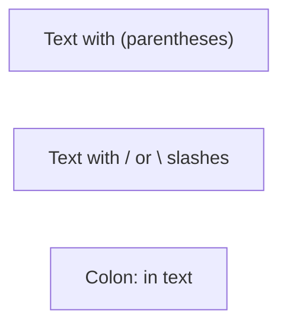
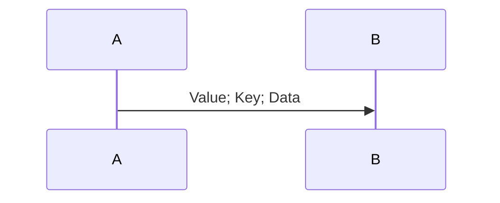
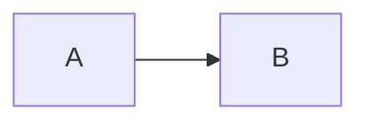
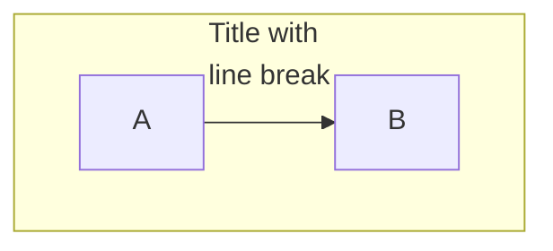
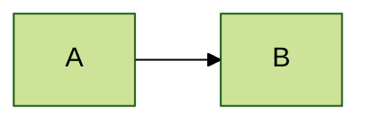
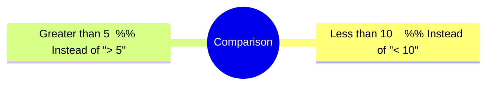
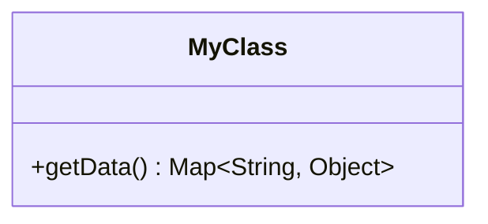
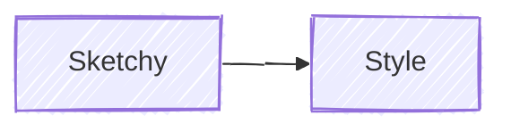
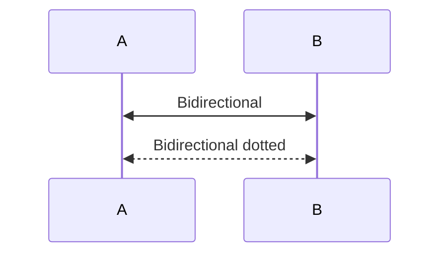
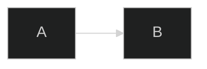

# Mermaid Diagram Syntax Guide

Comprehensive syntax reference for generating error-free Mermaid diagrams. Supports Mermaid v11.

**Test diagrams at:** https://mermaid.live/

**Prefer `flowchart` over `graph`:** Both work, but `flowchart` is the modern syntax with better feature support.

**When NOT to use this skill:** Non-Mermaid diagramming tools (D2, PlantUML, Graphviz, draw.io), or general markdown formatting.

## Critical Rules (Prevent 90% of Errors)

### 1. Special Character Escaping

**Always wrap text containing special characters in double quotes:**



**Characters requiring quotes:** `( ) [ ] { } / \ : ; # @ ! ? < > " '`

### 2. Reserved Words (Not Just "end"!)

Multiple reserved words break diagrams. Use quoted labels with safe IDs:

```mermaid
flowchart LR
    node1["end"]           %% Safe: quoted with different ID
    node2["default"]       %% Safe: "default" is also reserved
    node3["End"]           %% Safe: capitalized
```

**All reserved words (use quoted labels):**
- `end`, `default`
- `style`, `linkStyle`, `classDef`, `class`
- `call`, `href`, `click`, `interpolate`

**Pattern:** `safeId["reserved word text"]` instead of `reserved[text]`

### 3. Node ID Starting Characters

Nodes starting with `o` or `x` create unintended edge types:

```mermaid
flowchart LR
    orderNode[Order]    %% Good: full word
    oNode[O-Node]       %% Bad: might create circle edge
```

**Solution:** Use descriptive IDs, avoid single letters `o` or `x` at start.

### 4. HTML Entity Codes for Semicolons

In sequence diagrams, semicolons define line breaks. Use `#59;` for literal semicolons:



### 5. Comments Must Use %%

Single `%` breaks diagrams. Always use `%%`:



### 6. Subgraph with HTML Tags

Wrap subgraph titles containing `<br/>` in quotes:



### 7. Style Property Escaping

Escape commas in `stroke-dasharray` with backslash:


### 8. Frontmatter Must Be First Line

The `---` for frontmatter MUST be the only content on line 1:



**Wrong:** Any whitespace or content before `---` breaks the diagram.

### 9. Mindmap `<` Character Bug

In mindmaps, `<` renders as `&lt;`. Use words instead:



### 10. Class Diagram Colon Limitations

Colons in class member types are tricky. Use return type syntax:



**Note:** Complex generic types with colons may not render correctly.

### 11. Nested Subgraph Linking Bug

Linking to both parent AND nested subgraph causes syntax error. Link to nodes inside subgraphs, not the subgraph ID itself.

### 12. Subgraph Direction Inheritance

If subgraph nodes link to outside, direction is **ignored** (inherits parent). Subgraph direction only works if all nodes stay internal.

### 13. v11 Arrowless Edges Bug (v11.0-11.4)

The `---` (line without arrow) syntax is broken in v11.0-11.4 and shows arrows. **Fix:** Upgrade to Mermaid v11.5.0+.

### 14. v11 Markdown-by-Default Breaking Change

In v11, ALL node labels render as Markdown by default. Underscores in text become italic — use quotes: `B["file_name_here"]`.

### 15. Configuration Limits (Secure Settings)

`maxTextSize` (50,000) and `maxEdges` (500) are **secure settings** — CANNOT be set via frontmatter. Must use `mermaid.initialize()` in JavaScript.

### 16. linkStyle Hex Color as Last Attribute Bug

Hex color as the LAST attribute in linkStyle causes parsing error. Put hex color before other attributes, or use CSS color names.

### 17. Class Diagram Namespace Limitations

Relationships and notes MUST be defined OUTSIDE namespace blocks. Nested namespaces not supported.

### 18. Architecture Diagram Label Characters

Architecture node labels only support `[a-zA-Z0-9_ ]`. Hyphens and special chars break.

## Mermaid v11 New Features

### Hand-Drawn Look



### Bidirectional Arrows (Sequence)



### Configuration Directive



## Quick Reference Tables

### Flowchart Direction

| Syntax | Direction |
|--------|-----------|
| `flowchart TB` | Top to Bottom |
| `flowchart LR` | Left to Right |
| `flowchart BT` | Bottom to Top |
| `flowchart RL` | Right to Left |

### Node Shapes

| Syntax | Shape |
|--------|-------|
| `A[text]` | Rectangle |
| `A(text)` | Rounded rectangle |
| `A([text])` | Stadium |
| `A[(text)]` | Cylinder (database) |
| `A((text))` | Circle |
| `A{text}` | Diamond |
| `A{{text}}` | Hexagon |

### Edge Types

| Syntax | Type |
|--------|------|
| `A --> B` | Arrow |
| `A --- B` | Line (no arrow) |
| `A ==> B` | Thick arrow |
| `A -.-> B` | Dotted arrow |
| `A --text--> B` | Arrow with text |

**For complete syntax of all diagram types, see the reference files below.**

## Validation Checklist

Before finalizing any Mermaid diagram:

1. [ ] All text with special characters is quoted
2. [ ] No reserved words as node IDs (`end`, `default`, `style`, `class`, etc.)
3. [ ] No node IDs starting with single `o` or `x`
4. [ ] Semicolons in sequence messages use `#59;`
5. [ ] Nested quotes use single quotes or HTML entities
6. [ ] Subgraph titles are quoted if containing `<br/>` or special chars
7. [ ] Comments use `%%` (not single `%`)
8. [ ] `stroke-dasharray` commas escaped with `\,`
9. [ ] Frontmatter `---` is on the very first line
10. [ ] Mindmaps avoid `<` character (use words)
11. [ ] No links to both parent and nested subgraphs
12. [ ] If using `---` (arrowless), verify Mermaid v11.5+
13. [ ] Underscores in labels may render as italic in v11 (use quotes)
14. [ ] linkStyle: hex color NOT as last attribute
15. [ ] classDiagram: relationships and notes OUTSIDE namespace blocks
16. [ ] architecture-beta: labels use only `[a-zA-Z0-9_ ]`
17. [ ] Test at https://mermaid.live/ before committing

## Reference Library

**Detailed syntax for each diagram type:**
- [Flowchart Complete](references/flowchart-complete.md) — All 30+ node shapes, edge styling, subgraph nesting
- [Sequence Complete](references/sequence-complete.md) — All message types, boxes, breaks, critical sections
- [Class & State Complete](references/class-state-complete.md) — Class annotations, state concurrency, ER diagrams
- [Other Diagrams](references/other-diagrams.md) — Gantt, Pie, Git Graph, Mindmap, Timeline

**Working examples:**
- [Flowchart Examples](examples/flowchart-examples.md) — Common flowchart patterns
- [Sequence Examples](examples/sequence-examples.md) — API flow, auth flow patterns

**Tools:**
- **Live Editor:** https://mermaid.live/
- **Official Docs:** https://mermaid.js.org/intro/syntax-reference.html
